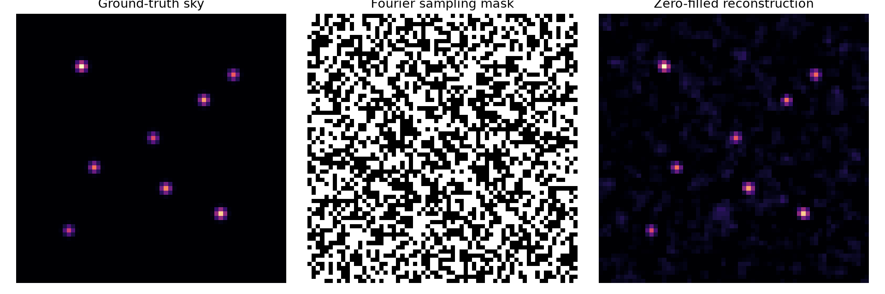

# Radio Sky Reconstruction
### A Simplified Example of Computational Imaging

## 1. Project Overview

This computational imaging project explores how an image of the sky can be reconstructed from incomplete and noisy Fourier measurements. Before examining the project in detail, it is important to address two fundamental questions: Why is image reconstruction important, and what is image reconstruction?

Image reconstruction refers to the computational recovery of an image from indirect, incomplete, or noisy measurements. In imaging modalities such as Computed Tomography (CT) and Magnetic Resonance Imaging (MRI), the acquired data are not images themselves. For example, a CT scanner records X-ray projections, while an MRI scanner samples the Fourier (k-) space of an object. Reconstructing an image from these measurements is therefore an inverse problem. In many cases, this problem is ill-posed because multiple candidate images may be consistent with the same measurements. To obtain a meaningful solution, regularisation techniques and prior information are often incorporated to stabilise the reconstruction process (Zhang & Dong, 2019).

While the examples above are drawn from medical imaging, image reconstruction is equally important in radio astronomy. Consider the task of imaging a distant galaxy using a radio telescope. Rather than relying on a single large dish, astronomers often use multiple radio antennas working together in an arrangement known as an interferometer. The antennas collect signals from the galaxy and combine them to produce measurements of the incoming radio waves. However, these measurements do not directly yield a complete image of the observed object. Instead, a reconstruction algorithm is required to recover the sky image from the available data.

In practice, radio interferometers do not sample all the information needed for a direct image recovery. As a result, the measured data are incomplete and often contaminated by noise. Image reconstruction algorithms are therefore essential for estimating the original sky image from these limited measurements. Developing methods that can reliably recover images under such conditions is a central challenge in computational imaging and forms the basis of this project.

in this project, a synthetic ground-truth sky image of size $64 \times 64$ pixels was generated by placing eight point sources with different brightness values at predefined spatial coordinates. Gaussian smoothing was applied to produce a spatially distributed intensity pattern. The two-dimensional Fourier transform was then applied to the ground-truth image to obtain its frequency-domain representation. Incomplete measurements were simulated using a binary random sampling mask with an initial sampling probability of $30%$. Conjugate symmetry was enforced to support reconstruction of a real-valued image, and complex-valued Gaussian noise was added to the Fourier measurements with a noise scale of $\sigma = 0.01$.

The reconstruction was obtained by applying a zero-filled inverse Fourier transform to the sampled measurements. The real component of the resulting image was retained, and negative pixel values were clipped to zero to enforce non-negativity. Reconstruction quality was evaluated by comparing the reconstructed image, $\hat{\mathbf{x}}$, with the original ground-truth image, $\mathbf{x}$, using relative reconstruction error, mean squared error (MSE), and peak signal-to-noise ratio (PSNR).

The experiment retained $51.73%$ of the Fourier measurements after enforcing conjugate symmetry and produced a relative reconstruction error of $0.6101$, an MSE of $0.000844$, and a PSNR of $30.73,\mathrm{dB}$. These results demonstrate a complete synthetic reconstruction pipeline, from image generation and Fourier-domain measurement simulation to image recovery and quantitative evaluation. 

As this is my first time working on an image reconstruction, I decided to keep things simple and reproducible by using **synthetic radio-sky image** to demonstrate the basic principles behind this problem. 

## 2. Research Question(This RQ was formulated, to guide the project)

**How accurately can a synthetic sky image be reconstructed from incomplete and noisy Fourier measurements using a zero-filled inverse Fourier transform?**

## 3. Project Objectives

The main objectives are to:

- Generate a synthetic image representing a simplified radio sky.
- Transform the image into the Fourier domain.
- Simulate incomplete Fourier measurements and add noise.
- Implement a zero-filled inverse Fourier transform as a baseline reconstruction method.
- Calculate accuracy of the reconstruction.

## 4. Mathematical Foundations

### 4.1 Representing the Sky Image

The synthetic sky is represented as a two-dimensional matrix:

$$
\mathbf{x}\in\mathbb{R}^{N\times N}
$$

where:

- $\mathbf{x}$ represents the complete image.
- $\mathbb{R}$ denotes the set of real numbers.
- $\mathbb{E}$ Belongs to/ Is an element of.
- $N$ is the number of rows and columns in the square image.

For this experiment, the image size is $64 \times 64$. Therefore,

$$
\mathbf{x}\in\mathbb{R}^{64\times64}
$$

The image contains $\(64\times64=4096\)$ pixel values.

The synthetic sky image is represented as a matrix:

$$
\mathbf{x}\in\mathbb{R}^{64\times64}
$$

More explicitly, the image matrix has the form:

$$
\mathbf{x}=
\begin{bmatrix}
x_{11} & x_{12} & \cdots & x_{1,64}\\
x_{21} & x_{22} & \cdots & x_{2,64}\\
\vdots & \vdots & \ddots & \vdots\\
x_{64,1} & x_{64,2} & \cdots & x_{64,64}
\end{bmatrix}
$$

The brightness at an individual pixel is represented by:

$$
x_{ij}
$$

Each $x_{ij}$ represents the brightness of a pixel at row $i$ and column $j$. The image contains $64\times64=4096$ pixel values.

where \(i\) is the row index and \(j\) is the column index.

For example, $x_{12}$ represents the brightness of the pixel at row 1, column 2 using mathematical indexing.

The synthetic image begins with a collection of point sources. Each source has a position and a brightness. The point sources are then smoothed using a Gaussian filter to create a simplified sky image.

### Point Sources

A point source is an idealised source of emission represented by a single location in an image. In this project, each point source is defined by its pixel coordinates and brightness.

The collection of $K$ point sources is represented as

$$
\mathcal{S}=\{(i_k,j_k,a_k)\}_{k=1}^{K}
$$

where:

- $K$ is the total number of point sources.
- $i_k$ is the row coordinate of source $k$.
- $j_k$ is the column coordinate of source $k$.
- $a_k$ is the brightness assigned to source $k$.

For this experiment, $K=8$. The sources are placed at predefined locations with different brightness values to create a sparse synthetic sky.

The initial sky image is constructed using

$$
x_{ij}=\sum_{k=1}^{K}a_k\delta_{i,i_k}\delta_{j,j_k}
$$

where $\delta$ is the Kronecker delta, which ensures that each source contributes brightness only at its assigned pixel location.

The sky begins as a collection of point sources. Each source is placed at a specific pixel location and assigned a brightness value.

For example,

$$
I(12,15)=1.0
$$

means that the pixel at row 12 and column 15 has brightness $\(1.0\)$.

Similarly,

$$
I(20,44)=0.8
$$

means that the pixel at row 20 and column 44 has brightness $\(0.8\)$.

### Mathematical Representation

Mathematically, the sky can be written as a sum of discrete point sources:

$$
I(x,y)=\sum_{k=1}^{8}a_k\,\delta(x-x_k,y-y_k)
$$

where:

- $a_k$ is the brightness of the $k$-th source.
- $(x_k, y_k)$ is the location of the $k$-th source.
- $\delta$ is the two-dimensional discrete delta (impulse) function.

### Example: A Single Point Source

For a single source located at $\((12,15)\)$ with brightness $\(1.0\)$:

$$
I(x,y)=1.0\,\delta(x-12,y-15)
$$

The minus signs do not indicate subtraction of brightness. They specify the location at which the delta function is centred.

The source is located where the arguments of the delta function are zero:

$$
x-12=0 \quad\Rightarrow\quad x=12
$$

and

$$
y-15=0 \quad\Rightarrow\quad y=15
$$

Thus,

$$
\delta(x-12,y-15)
$$

represents a point source at pixel $\((12,15)\)$.

### Two Dimensions

In this project, we use two-dimensional coordinates $(x,y)$ to identify pixel locations.

A point source at row 12, column 15 is represented mathematically as:

```math
\delta(x - 12, y - 15)
```

This function is non-zero only when:

```math
x = 12
```

and

```math
y = 15
```

Therefore, it represents a single bright pixel located at $(12,15)$.

### Complete Synthetic Sky

The complete synthetic sky consists of eight point sources:

$$
\begin{aligned}
I(x,y)={}&1.0\,\delta(x-12,y-15)\\
&+0.8\,\delta(x-20,y-44)\\
&+0.7\,\delta(x-36,y-18)\\
&+0.9\,\delta(x-47,y-48)\\
&+0.6\,\delta(x-29,y-32)\\
&+0.55\,\delta(x-51,y-12)\\
&+0.65\,\delta(x-14,y-51)\\
&+0.75\,\delta(x-41,y-35).
\end{aligned}
$$

Each delta function places a source at its specified pixel location, while its coefficient determines the source's brightness.

Our objective is to estimate $\mathbf{x}$ from incomplete and noisy Fourier measurements.

Therefore, the general measurement model is:

```math
y = M \odot \mathcal{F}(x) + M \odot n
```

where:

| Symbol | Meaning |
|---|---|
| $\mathbf{x}$ | Original sky image |
| $\mathcal{F}$ | Two-dimensional Fourier transform |
| $\mathbf{M}$ | Fourier sampling mask |
| $\odot$ | Element-wise multiplication |
| $\mathbf{n}$ | Simulated complex noise |
| $\mathbf{y}$ | Incomplete, noisy Fourier measurements |

This is the central equation behind the simulation.

The rest of the project is about understanding this equation and finding a good estimate of $\mathbf{x}$ from $\mathbf{y}$.

### 2.3 Smooth the Sources with a Gaussian Filter

Your code then applies:

```python
sky = gaussian_filter(sky, sigma=0.8)
```

A Gaussian kernel in two dimensions is defined as:

$$
G_\sigma(i,j) = \frac{1}{2\pi\sigma^2} \exp\left(-\frac{i^2+j^2}{2\sigma^2}\right)
$$

where $\sigma$ controls the width of the smoothing.

The smoothed image is approximately the convolution of the original image with the Gaussian kernel:

$$
\mathbf{x}_s = \mathbf{x}_0 * G_{\sigma}
$$

where:

- $\ast$ denotes convolution.
- $\mathbf{x}_0$ is the original point-source image.
- $\mathbf{x}_s$ is the smoothed image.

Smoothing spreads each bright pixel across neighbouring pixels, creating more realistic-looking compact sources for this demonstration.

Finally, the image is normalised:

$$
\mathbf{x} = \frac{\mathbf{x}_s}{\displaystyle\max_{i,j} x_{s,ij}}
$$

This ensures that the maximum brightness is $1$.

**Note:** This is a synthetic test image, not a physically calibrated astronomical sky.

## Gaussian Smoothing and the Meaning of $I_{\text{smooth}}(12,15)$

Initially, the synthetic sky is created using a collection of point sources. For example:

```math
I(12,15) = 1.0
```

This means that the pixel at row 12 and column 15 has a brightness of 1.0, while most other pixels have a brightness of 0.

Mathematically, the unsmoothed sky can be represented as a sum of discrete point sources:

```math
I(x,y) = \sum_{k=1}^{8} a_k \, \delta(x-x_k, y-y_k)
```

where:

- $a_k$ is the brightness of the $k$-th source.
- $(x_k,y_k)$ is the location of the $k$-th source.
- $\delta$ is the two-dimensional discrete delta (impulse) function.

### Applying the Gaussian Filter

These point sources are then blurred using a Gaussian filter:

```python
sky = gaussian_filter(sky, sigma=0.8)
```

The two-dimensional Gaussian kernel is defined as:

```math
G_{\sigma}(x,y) = \frac{1}{2\pi\sigma^2}\exp\left(-\frac{x^2+y^2}{2\sigma^2}\right)
```

where $\sigma=0.8$ controls the width of the blur.

The smoothing operation can be expressed as a convolution between the original image and the Gaussian kernel:

```math
I_{\text{smooth}}(x,y) = (I * G_{\sigma})(x,y)
```

In discrete form:

```math
I_{\text{smooth}}(m,n) = \sum_i \sum_j I(i,j)\,G_{\sigma}(m-i,n-j)
```

This means that the brightness at each output pixel is calculated by combining the brightness values of neighbouring input pixels, weighted according to the Gaussian kernel. Nearby pixels generally contribute more strongly than distant pixels.

---

### What Does $I_{\text{smooth}}(12,15)$ Mean?

The notation

```math
I_{\text{smooth}}(12,15)
```

represents the brightness of the pixel at row 12 and column 15 **after Gaussian smoothing has been applied**.

Before smoothing:

```math
I(12,15)=1.0
```

The source's brightness is concentrated in a single pixel.

After smoothing, the brightness is distributed across neighbouring pixels. The value at the original source location is calculated as:

```math
I_{\text{smooth}}(12,15) = \sum_i \sum_j I(i,j)\,G_{\sigma}(12-i,15-j)
```

In other words, the filter considers the input pixels, weights their contributions using the Gaussian kernel, and combines them to produce the output pixel value.

As a result:

- The original bright pixel becomes less concentrated.
- Neighbouring pixels receive non-zero brightness values.
- The source appears as a compact, blurred spot rather than a single bright pixel.
- The image resembles an astronomical image in which the instrument's point-spread function broadens the apparent source.

### Conceptual Example

Before smoothing, a simplified $3\times3$ image might look like this:

```text
0  0  0
0  1  0
0  0  0
```

After smoothing, the image might look conceptually like this:

```text
0.05  0.12  0.05
0.12  0.32  0.12
0.05  0.12  0.05
```

These numbers are illustrative only. They are not the exact output of a Gaussian filter with `sigma=0.8`. The actual values depend on the filter, the input image, and the treatment of image boundaries.

The central pixel's brightness decreases as some of its intensity is distributed to neighbouring pixels.

Therefore, $I_{\text{smooth}}(12,15)$ means:

> The brightness value at row 12 and column 15 after Gaussian smoothing has spread the original point-source brightness across neighbouring pixels.

**Note:** This is a synthetic demonstration. Gaussian smoothing approximates blurring, but it does not by itself produce a physically calibrated astronomical image.

## Normalisation

Normalisation ensures that pixel intensities lie within a consistent range, regardless of how the image was generated or smoothed.
After Gaussian smoothing, the image is normalised using:

```python
sky /= sky.max()
```

This operation divides every pixel value in the image by the largest pixel value.

If the maximum brightness in the smoothed image is

```math
M = \max_{x,y} I_{\text{smooth}}(x,y)
```

then the normalised image is

```math
I_{\text{norm}}(x,y) = \frac{I_{\text{smooth}}(x,y)}{M}
```

As a result, the brightest pixel in the image becomes exactly 1:

```math
\max_{x,y} I_{\text{norm}}(x,y) = 1
```

All other pixel values are scaled proportionally and therefore satisfy

```math
0 \leq I_{\text{norm}}(x,y) \leq 1
```

For example, suppose the peak brightness after Gaussian smoothing is

```math
M = 0.248
```

A pixel with brightness

```math
I_{\text{smooth}}(12,15) = 0.248
```

becomes

```math
I_{\text{norm}}(12,15) = \frac{0.248}{0.248} = 1
```

A neighbouring pixel with brightness

```math
I_{\text{smooth}}(13,15) = 0.124
```

becomes

```math
I_{\text{norm}}(13,15) = \frac{0.124}{0.248} = 0.5
```

The relative brightness structure of the image remains unchanged, but all values are rescaled into the interval $[0,1]$.

---

## Effect on the Synthetic Sky

Before normalisation, Gaussian smoothing spreads the intensity of each point source over multiple neighbouring pixels. The brightest source may have a peak value below 1 because some of its intensity has been distributed to surrounding pixels.

After normalisation:

```math
I_{\text{norm}}(x,y) = \frac{I_{\text{smooth}}(x,y)}{\max_{x,y} I_{\text{smooth}}(x,y)}
```

The brightest location in the image is restored to a value of 1, while all other pixels are scaled relative to that peak.

This makes the synthetic sky easier to visualise, compare, and process in later stages of the reconstruction pipeline without changing its relative brightness structure.


## 4.2 The Fourier Transform

The Fourier transform expresses an image in terms of spatial frequencies. These frequencies describe how image brightness varies across space.

The two-dimensional discrete Fourier transform (DFT) is defined here using an orthonormal normalisation convention:

```math
X_{uv} = \frac{1}{N} \sum_{i=0}^{N-1} \sum_{j=0}^{N-1} x_{ij} \exp\left[-\frac{2\pi \mathrm{i}}{N}(ui+vj)\right]
```

where:

- $x_{ij}$ is the pixel brightness in the original image.
- $X_{uv}$ is the Fourier coefficient at frequency coordinates $(u,v)$.
- $N$ is the image dimension, assuming a square $N \times N$ image.
- $\mathrm{i}=\sqrt{-1}$ is the imaginary unit.
- $u$ and $v$ index the spatial frequencies.
- $\(N\)$ is the image size.

The Fourier coefficients are generally complex-valued. Each coefficient contains magnitude and phase information.

In Python, this transformation is implemented using:

```python
def fft2(image):
    return np.fft.fft2(image, norm="ortho")
```

The inverse Fourier transform converts the frequency-domain representation back into an image:

```math
x_{ij} = \frac{1}{N} \sum_{u=0}^{N-1} \sum_{v=0}^{N-1} X_{uv} \exp\left[\frac{2\pi \mathrm{i}}{N}(ui+vj)\right]
```

When all Fourier coefficients are available, the inverse transform can recover the original image, up to numerical precision. When measurements are missing, the problem becomes more difficult.

### 3.2 What Does a Fourier Coefficient Contain?

Each Fourier coefficient is generally a complex number:

```math
X_{uv} = a_{uv} + \mathrm{i}b_{uv}
```

where $a_{uv}$ is the real part and $b_{uv}$ is the imaginary part.

It has a magnitude:

```math
|X_{uv}| = \sqrt{a_{uv}^{2} + b_{uv}^{2}}
```

and a phase:

```math
\phi_{uv} = \text{atan2}(b_{uv}, a_{uv})
```

Magnitude describes the strength of that frequency component, while phase describes its relative alignment and is essential for locating structures in the reconstructed image.

Broad spatial patterns tend to contribute strongly to low spatial frequencies, while sharp features and fine details contribute to higher spatial frequencies.

### 3.3 Why Use `norm="ortho"`?

Orthonormal scaling gives the Fourier transform and its inverse consistent scaling:

```math
\mathcal{F}^{-1}\left(\mathcal{F}(\mathbf{x})\right) = \mathbf{x}
```

It also satisfies Parseval's identity:

```math
\sum_{i,j}|x_{ij}|^{2} = \sum_{u,v}|X_{uv}|^{2}
```

This means that the total squared magnitude is preserved by the transform.

The code uses NumPy's Fast Fourier Transform (FFT) algorithm, which computes the discrete Fourier transform (DFT) efficiently.

**The distinction:** The DFT is the mathematical transformation, while the FFT is an algorithm for computing it efficiently.

## Mathematics of the Fourier Sampling Mask

Your code creates a binary sampling mask:

```python
mask = random_generator.random((size, size)) < fraction
mask[0, 0] = True
```

Each element of the mask is either zero or one:

```math
M_{uv} \in \{0,1\}
```

The random sampling rule is:

```math
M_{uv} =
\begin{cases}
1, & r_{uv} < p, \\
0, & r_{uv} \geq p
\end{cases}
```

where $r_{uv}$ is a uniformly distributed random number between 0 and 1, and $p$ is the requested sampling fraction.

For this project:

```math
p = 0.30
```

Before the symmetry operation, each entry has probability $p$ of being selected. The expected number of selected entries is $pN^2$, apart from the forced selection at $(0,0)$.

### 4.1 Apply the Mask to the Fourier Transform

The observed clean measurements are:

```math
Y_{uv}^{\mathrm{clean}} = M_{uv}X_{uv}
```

If $M_{uv}=1$, the Fourier coefficient is retained. If $M_{uv}=0$, it is set to zero.

This is the mathematical operation behind:

```python
clean_measurements = mask * fft2(sky)
```

The symbol $\odot$ is often used to denote element-wise multiplication. Therefore, the same operation can be written as:

```math
\mathbf{Y}^{\mathrm{clean}} = \mathbf{M} \odot \mathbf{X}
```

### 4.2 Conjugate Symmetry for Real-Valued Images

For a real-valued image, its Fourier transform obeys conjugate symmetry:

```math
X_{(-u)\bmod N,\,(-v)\bmod N} = \overline{X_{uv}}
```

where the overline denotes complex conjugation.

This means that coefficients at opposite frequency coordinates are complex conjugates of each other.

Your code enforces matching symmetry in the sampling mask:

```python
negative_indices = (-np.arange(size)) % size

mirrored = mask[np.ix_(negative_indices, negative_indices)]

mask = mask | mirrored
```

Mathematically, this is equivalent to:

```math
M_{\mathrm{sym}} = M \lor M_{\mathrm{mirror}}
```

where $\lor$ denotes element-wise logical OR.

The resulting mask is symmetric under the frequency-index mapping.

**Important distinction:** A symmetric mask does not automatically guarantee that noisy measurements are conjugate-symmetric. This must also be considered when generating the noise. Additionally, this random mask is a simplified sampling model, not a realistic model of radio-interferometer baseline coverage.

### 4.3 Calculate the Actual Sampling Fraction

The final fraction of selected Fourier positions is:

```math
p_{\mathrm{actual}} = \frac{1}{N^2}\sum_{u=0}^{N-1}\sum_{v=0}^{N-1} M_{uv}
```

In Python:

```python
mask.mean()
```

The final sampling fraction can exceed $0.30$ because the symmetry operation can add measurements. This is expected.

## Mathematics of the Noise Model

Your code creates complex Gaussian noise:

```python
noise = (
    random_generator.normal(size=sky.shape)
    + 1j * random_generator.normal(size=sky.shape)
) / np.sqrt(2.0)
```

### 5.1 Define Complex Noise

Each noise value is defined as:

```math
n_{uv} = \frac{a_{uv} + \mathrm{i}b_{uv}}{\sqrt{2}}
```

where the real and imaginary components are independent standard normal random variables:

```math
a_{uv}, b_{uv} \overset{\mathrm{iid}}{\sim} \mathcal{N}(0,1)
```

Here, $\mathcal{N}(0,1)$ denotes a normal distribution with mean zero and variance one. The symbol $\mathrm{i}$ is the imaginary unit, where $\mathrm{i}^2=-1$.

The real and imaginary components of the noise each have a mean of zero:

```math
\mathbb{E}[\text{Re}(n_{uv})] = 0
```

```math
\mathbb{E}[\text{Im}(n_{uv})] = 0
```

Their variances are both one-half:

```math
\text{Var}(\text{Re}(n_{uv})) = \frac{1}{2}
```

```math
\text{Var}(\text{Im}(n_{uv})) = \frac{1}{2}
```

Consequently, the expected squared magnitude of the complex noise is one:

```math
\mathbb{E}[|n_{uv}|^2] = 1
```

This is called **unit-power complex Gaussian noise**.

### 5.2 Scale the Noise

The code adds noise to the Fourier measurements and applies the sampling mask:

```math
Y_{uv} = M_{uv}X_{uv} + M_{uv}\sigma n_{uv}
```

where:

- $Y_{uv}$ is the observed Fourier measurement.
- $M_{uv}$ is the binary sampling mask.
- $X_{uv}$ is the clean Fourier coefficient.
- $\sigma$ is the noise scaling parameter.
- $n_{uv}$ is the unit-power complex Gaussian noise.

In your experiment, `noise_sigma` is set to `0.01`, so:

```math
\sigma = 0.01
```

The complete observation model is:

```math
\mathbf{Y} = \mathbf{M} \odot \left(\mathcal{F}(\mathbf{x}) + \sigma\mathbf{n}\right)
```

Here, $\mathcal{F}(\mathbf{x})$ denotes the Fourier transform of the image, and $\odot$ denotes element-wise multiplication.

Because the mask multiplies both the signal and the noise, unselected Fourier positions contain zero. At selected positions, the standard deviation of each real and imaginary noise component is:

```math
\frac{\sigma}{\sqrt{2}}
```

For $\sigma = 0.01$, this is approximately $0.00707$ per component.


### 4.3 Incomplete Fourier Measurements

In this project, not every Fourier coefficient is observed. A binary sampling mask is used to indicate which measurements are available:

$$
M_{uv}\in\{0,1\}
$$

where:

$$
M_{uv}=
\begin{cases}
1,&\text{if the measurement is available},\\
0,&\text{if the measurement is missing}.
\end{cases}
$$

The incomplete measurement process is modelled as:

$$
y_{uv}=M_{uv}(X_{uv}+\sigma n_{uv})
$$

where:

- $y_{uv}$ is the observed Fourier measurement.
- $X_{uv}$ is the true Fourier coefficient.
- $M_{uv}$ is the sampling mask.
- $\sigma$ controls the noise amplitude.
- $n_{uv}$ is a complex-valued noise sample.

The complete measurement model can also be written as:

$$
\mathbf{y} = \mathbf{M}\odot\left(\mathcal{F}(\mathbf{x})+\sigma\mathbf{n}\right)
$$

Here, \(\mathcal{F}\) denotes the two-dimensional Fourier transform and \(\odot\) denotes element-wise multiplication.

A sampling fraction of approximately \(30\%\) is used as the initial target. The actual fraction may differ because the mask is adjusted to maintain conjugate symmetry for real-valued images.

This random sampling strategy is a simplified educational model. It does not reproduce the baseline geometry, visibility sampling, or other instrumental effects of a real radio interferometer.

### 4.4 Zero-Filled Inverse Fourier Reconstruction

The first reconstruction method is the zero-filled inverse Fourier transform.

Missing Fourier coefficients are treated as zero, and the inverse Fourier transform is applied:

$$
\mathbf{x}_{\mathrm{raw}} = \mathrm{Re}\{\mathcal{F}^{-1}(\mathbf{M}\odot\mathbf{y})\}
$$

The real part is retained because the target image is real-valued.

A non-negativity constraint is then applied:

$$
\hat{x}_{ij}=\max(0,x_{\mathrm{raw},ij})
$$

where \(\hat{\mathbf{x}}\) is the reconstructed image.

This method provides a simple baseline, but missing Fourier measurements can produce blurring and artefacts. The non-negativity operation is a basic constraint rather than a complete physical model of radio imaging.



In the future, this project will compares three approaches:

| Method | Description | Purpose |
|---|---|---|
| Zero-filled inverse FFT | Applies the inverse Fourier transform after filling missing measurements with zeros | Baseline |

The methods will be evaluated using the same synthetic sky and measurement data for each experiment. This helps make comparisons fair and reproducible.

## 6. Evaluation Metrics

### 6.1 Relative Reconstruction Error

The relative \(L_2\) reconstruction error compares the reconstructed image with the ground-truth image:

$$
E_{rel} = \frac{||\hat{x} - x||_2}{||x||_2}
$$

A smaller value indicates that the reconstructed image is closer to the ground truth in relative \(L_2\) error.

### 6.2 Mean Squared Error

The mean squared error (MSE) measures the average squared difference between corresponding pixels:

$$
\mathrm{MSE} = \frac{1}{N^2}\sum_{i=0}^{N-1}\sum_{j=0}^{N-1}(\hat{x}_{ij}-x_{ij})^2
$$

A lower MSE indicates smaller average squared pixel errors.

### 6.3 Peak Signal-to-Noise Ratio

The peak signal-to-noise ratio (PSNR) is derived from MSE:

$$
\mathrm{PSNR} = 10\log_{10}\left(\frac{L^2}{\mathrm{MSE}}\right)
$$

where \(L\) is the maximum possible pixel value. For images normalised to the range \([0,1]\), \(L=1\).

A higher PSNR generally indicates lower pixel-wise reconstruction error. PSNR should be interpreted alongside visual inspection and other metrics.

## 7. Experimental Design

The initial experiment uses the following settings:

| Parameter | Setting |
|---|---|
| Image dimensions | 64 × 64 pixels |
| Initial sampling probability | 30% |
| Actual Fourier sampling fraction | 51.73% |
| Fourier noise scale | $\sigma = 0.01$ |
| Random seed | 7 |
| Reconstruction method | Zero-filled inverse FFT |
| Relative reconstruction error | 0.6101 |
| Mean Squared Error (MSE) | 0.000844 |
| Peak Signal-to-Noise Ratio (PSNR) | 30.73 dB |

## 8. Project Structure

The intended project structure is:

```text
radio-sky-reconstruction/
├── .venv/
├── src/
│   └── reconstruct.py
├── results/
│   └── first_reconstruction.png
├── requirements.txt
└── README.md
```

- `src/reconstruct.py`: generates the synthetic sky, simulates measurements, performs the baseline reconstruction, and saves the initial visualisation.
- `results/`: stores generated images and, in future, evaluation plots and numerical results.
- `requirements.txt`: lists the Python dependencies.
- `README.md`: documents the research question, mathematical model, methods, and experiments.

## 9. Requirements

The project uses Python and the following libraries:

- NumPy
- SciPy
- Matplotlib

Install the dependencies in an activated virtual environment:

```bash
pip install -r requirements.txt
```

The `requirements.txt` file contains:

```text
numpy
scipy
matplotlib
```

## 10. Running the Project

From the project root directory, activate the virtual environment:

```bash
source .venv/bin/activate
```

Run the initial reconstruction:

```bash
python src/reconstruct.py
```

The program prints the image size, actual sampling fraction, and relative reconstruction error. It also displays a visual comparison of:

1. The ground-truth synthetic sky.
2. The Fourier sampling mask.
3. The zero-filled reconstruction.

The generated image is saved to:

```text
results/first_reconstruction.png
```

## 11. Current Scope and Limitations

This project is a simplified computational imaging experiment. Its limitations include:

- The sky image is synthetically generated rather than obtained from real astronomical observations.
- The sampling mask is randomly generated and does not represent realistic interferometer baseline coverage.
- The noise model is simplified and does not capture all sources of instrumental or observational noise.
- The initial reconstruction method is deliberately simple.
- A Gaussian denoiser is only a starting point for PnP and does not represent a learned image prior.
- Results on a single synthetic image cannot establish that a method will generalise to real radio astronomy data.
- PnP convergence must be investigated rather than assumed.

These limitations will be documented when reporting results.

## 12. Expected Outcomes

The project aims to produce:

- A reproducible synthetic reconstruction experiment.
- A baseline reconstruction against which more advanced methods can be compared.
- Implementations of FISTA and Plug-and-Play reconstruction.
- Quantitative comparisons using reconstruction error, MSE, PSNR, and measurement residuals.
- Plots showing the effect of sampling, noise, and iteration count.
- A discussion of the trade-offs between data fidelity, sparsity, denoising, and convergence behaviour.

The results will be used to assess the strengths and weaknesses of the tested methods under the specific experimental conditions, rather than to claim that one method is universally superior.

## 13. Research Motivation

Recovering images from incomplete measurements is a central challenge in computational imaging. The problem connects Fourier analysis, inverse problems, optimisation, regularisation, and prior-based reconstruction.

This project provides a practical foundation for exploring those concepts in a controlled setting. It also creates an opportunity to investigate how reconstruction accuracy and algorithmic stability change when information is missing or measurements are noisy.

## 14. Further Reading

The following foundational works provide context for the methods used in this project:

- Beck, A. and Teboulle, M. (2009). *A Fast Iterative Shrinkage-Thresholding Algorithm for Linear Inverse Problems.* SIAM Journal on Imaging Sciences, 2(1), 183–202.
- Venkatakrishnan, S. V., Bouman, C. A. and Wohlberg, B. (2013). *Plug-and-Play Priors for Model Based Reconstruction.* IEEE Global Conference on Signal and Information Processing.
- Fessler, J. A. (2010). *Model-Based Image Reconstruction for MRI.* IEEE Signal Processing Magazine, 27(4), 81–89.

These references provide background on accelerated proximal optimisation, Plug-and-Play priors, and model-based image reconstruction. They do not imply that the present simplified experiment reproduces the full methods or assumptions in those works.

---

**Project status:** Initial synthetic sky generation, Fourier sampling, and zero-filled inverse FFT reconstruction are the first implementation stage. FISTA, Plug-and-Play, and systematic evaluation are planned extensions.
